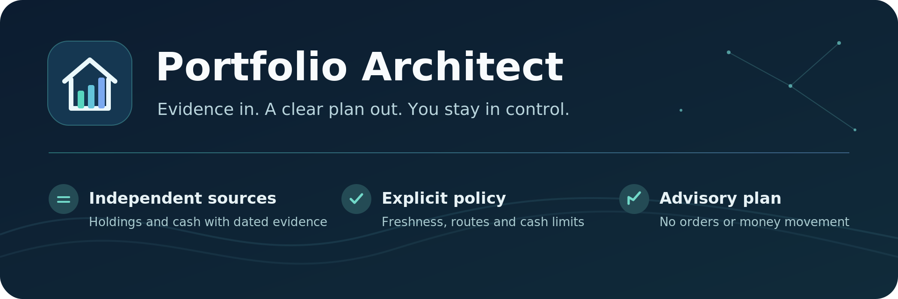

# Portfolio Architect

**A clear investment plan from portfolio evidence you control.** Portfolio Architect brings holdings and eligible EUR investment cash into Home Assistant, checks freshness and policy, then proposes purchases and funding routes. Every recommendation is advisory: it cannot place orders or move money.

## At a glance

| See your portfolio | Understand the decision | Stay in control |
| --- | --- | --- |
| Combine separately acquired holdings and cash from multiple providers. | See source dates, policy findings, route costs and plan blockers in native entities and English/German dashboards. | Choose acquisition authority and investment cash limits explicitly. No silent fallback to an older source. |

## Supported sources

| Gateway App | Acquisition |
| --- | --- |
| Comdirect | Live API, or explicitly activated complete holdings and cash CSV |
| DKB | Depot and Girokonto CSV, or explicitly activated manual FinTS holdings and selected-account booked cash |
| Trade Republic | Local `DEPOTAUSZUG` holdings and `KONTOAUSZUG` cash PDF imports |
| Generic Import | Mapped holdings CSV, with optional EUR cash; up to eight separate profiles |

Each Gateway App acquires its provider data separately and publishes a bounded snapshot over verified private HTTPS. DKB FinTS evidence requires a manual read, may require banking-app approval and expires after 14 days. An upgrade preserves the currently selected DKB authority; a switch between CSV and FinTS is explicit. Missing or expired evidence does not activate the other method automatically.

## Set up your plan

1. Add **Portfolio Architect** in **Settings → Devices & services**. A new installation starts without an invented source or investment assumptions.
2. Install and configure the relevant Gateway Apps through **Settings → Apps** or as local Apps, then explicitly adopt a ready source.
3. Define your target allocation, cash authorization, policies and verified execution routes in the native setup flows.

The [installation guide](docs/INSTALL.md), [DKB authority guide](docs/UPGRADE-1.66.2.md) and [dashboard guide](dashboard/README.md) give the detailed steps. See [release notes](docs/RELEASE-NOTES.md) before upgrading.

<!-- ha-marketplace:exclude-start -->
## Install the integration

Home Assistant **2026.7.0 or newer** is required. On **2026.11 or newer**, open **Settings → Marketplace** and install Portfolio Architect; if it is not in your catalog, use **Add from link** with this repository's GitHub URL. On **2026.7–2026.10**, add this repository to HACS as a custom **Integration** repository. A versioned manual drop-in is also available. The Gateway Apps are separate Home Assistant Apps and are not installed by Marketplace or HACS. Follow [the installation guide](docs/INSTALL.md) for setup and restart details.

## Development

The repository includes regression tests, reproducible release archives, privacy checks, and pinned HACS and hassfest validation workflows. See [quality and validation](docs/QUALITY.md) and [publishing](docs/PUBLISHING.md).

## AI-assisted development

Generative AI assists implementation, tests, documentation and release preparation. The maintainer retains responsibility for architecture, security, review, merging and publication. See [AI_POLICY.md](AI_POLICY.md).
<!-- ha-marketplace:exclude-end -->

## Security and privacy

Bank credentials, authentication sessions, raw statements and full account identifiers stay outside Home Assistant entities and diagnostics. Provider acquisition remains in isolated Gateway Apps; Portfolio Architect receives only validated portfolio, authorized cash and bounded health evidence. It never executes a transaction.

Read the [privacy model](docs/PRIVACY.md), [security policy](SECURITY.md) and [architecture](docs/ARCHITECTURE.md).
